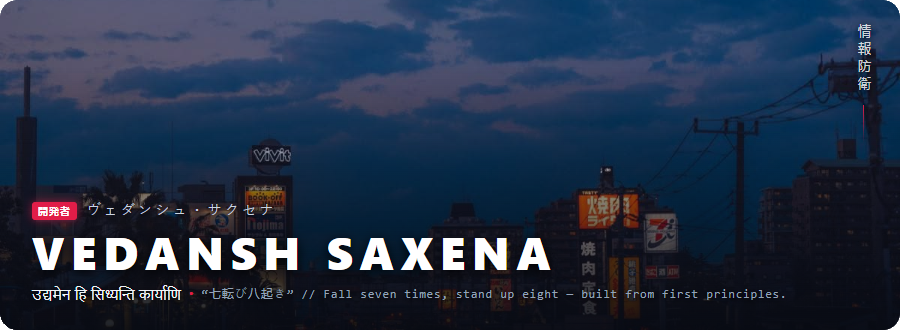

<br>
<div align="center">

[](https://instagram.com/_vedansh.saxena_)
[](https://github.com/vedanshsaxena23)
[](https://github.com/vedanshsaxena23?tab=followers)
[](https://linkedin.com/in/itsvedanshsaxena)


### 根性 • 探究 • 構築
####  Learning • Building • Improving
*Learning, building, breaking, and improving software one project at a time.*


[](https://code.visualstudio.com/)
[](https://antigravity.app/)
[](https://python.org/)
[](https://docker.com/)
[](https://nodejs.org/)
[](https://react.dev/)
[](https://electronjs.org/)

</div>

---
# 👽 About Me • 自己紹介 • आत्मपरिचय

I'm a cybersecurity student who enjoys building software, exploring systems, and understanding how technology works beneath the surface.

Most of my time is spent learning something related to Python, React, Docker, local AI, or cybersecurity while trying to turn curiosity into useful software.

For reasons I still can't fully explain, nearly every project, README, wallpaper, UI mockup, and personal website somehow ends up with a Japanese cyberpunk aesthetic. Neon-lit cityscapes, terminal interfaces, red accent colors, and Japanese typography have quietly become part of my personal development environment.

```sh
vedansh@system:~$ whoami
```

```txt
Role         : Cybersecurity Student
Interests    : Python, React, Local AI, Security
Current Goal : Learn something new every day

Warning:
Repeated exposure to Japanese cyberpunk media
has permanently affected all design decisions.

Side Effects:
- README files become futuristic
- Wallpapers become neon
- Projects receive unnecessary terminal interfaces
- Everything eventually turns blue, black, and crimson
- Random Japanese text appears in unexpected places
- "Minimal UI" somehow becomes cyberpunk again
```
---


### ⚡ Background & Focus • 任務概要 • कार्यसारः

```sh
vedansh@system:~$ cat about.json
```

```json
{
  "focus": [
    "Learning Cybersecurity",
    "Building Projects",
    "Understanding How Things Work"
  ],
  "interests": [
    "Python Development",
    "React Applications",
    "Local AI",
    "Desktop Software"
  ],
  "core_principles": [
    "Learn by building",
    "Break things and fix them",
    "Keep improving one project at a time"
  ],
  "currently_exploring": [
    "Computer Security",
    "Docker",
    "Local LLMs",
    "Systems Programming"
  ]
}
```
---
### 🚀 Highlighted Work • 代表作品 • प्रमुखकृतयः

```
📦 Open-Source Implementations
└── 📋 GlyphBoard (Aegis)
    └── Local-first encrypted clipboard & developer snippet workspace with zero remote dependencies.
        [TypeScript • React • Monaco • Encrypted SQLite • GPL-3.0]
```

---

### 🛠️ Technical Arsenal • 技術兵装 • तांत्रिकायुधागारः

| Layer | Technologies & Tooling |
|--------|----------------------|
| **Languages** | `Python` `JavaScript` `TypeScript` `C` `C++` `SQL` |
| **Backend** | `Flask` `FastAPI` |
| **Frontend** | `React` `Vite` `Tailwind CSS` |
| **Databases** | `SQLite` `MySQL` `IndexedDB` |
| **Tools & Platforms** | `Docker` `Git` `Linux` |
| **Exploring** | `Electron` `Cybersecurity` `Local AI (GGUF, llamafile)` |

---

### 🔧 Development Loadout • 開発装備 • विकासोपकरणसञ्चयः

```sh
vedansh@system:~$ tools --daily
```

```json
{
    "editor": "VS Code",
    "frontend": "React",
    "desktop_apps": "Electron",
    "containers": "Docker",
    "runtime": "Node.js",
    "local_ai": "Antigravity",
    "special_ability": "Turning simple ideas into 3GB project folders",
    "known_issues": [
        "Creates a new virtual environment for everything",
        "Spends 30 minutes debugging a typo",
        "Refuses to delete old projects"
    ]
}
```
---

### 🎮 Beyond The Terminal • 端末の向こう側 • तन्त्रपटलात् परे

When I'm not debugging code, breaking Docker containers, or creating suspiciously large project folders:

#### 📺 Favorite Series • 愛読映像作品 • प्रियधारावाहिकाः

- **Loki** → Time travel, chaos, and the best character development in the MCU.
- **Reacher** → Solving problems through investigation, intelligence, and occasionally excessive force.
- **The Terminal List** → Military thriller with zero chill.
- **The Recruit** → Spycraft, bureaucracy, and bad decisions at government scale.
- **Lanterns (HBO)** → Currently waiting for deployment.

#### 🎮 Favorite Games • 愛好ゲーム • प्रियक्रीडाः

- **Nine Sols** → Gorgeous art, brutal combat, and "one more attempt" turning into three hours.
- **Tomb Raider** → Exploration, puzzles, ancient mysteries, and Lara Croft being significantly better prepared than I am.

#### ⚡ Recurring Themes I Apparently Like • 好みの主題 • प्रियविषयाः

- Cybersecurity & intelligence operations
- Government conspiracies
- Ancient mysteries
- Systems that are more complicated than they first appear
- Characters too stubborn to quit
- Learning through repeated failure

#### 🐛 Known Issue • 既知の不具合 • ज्ञातदोषः

> "I'll watch one episode" and "I'll play for 30 minutes" have both been experimentally proven false.

---

### 📈 Development Activity Log • 開発活動記録 • विकासकार्यवृत्तान्तः

<div align="center">
  
</div>

---


<div align="center">
  <sub>
    Built with relentless curiosity • 七転び八起き • <b>उद्यमेन हि सिध्यन्ति कार्याणि</b>
  </sub>
</div>

<!--
**vedanshsaxena23/vedanshsaxena23** is a ✨ _special_ ✨ repository because its `README.md` (this file) appears on your GitHub profile.

Here are some ideas to get you started:

- 🔭 I’m currently working on ...
- 🌱 I’m currently learning ...
- 👯 I’m looking to collaborate on ...
- 🤔 I’m looking for help with ...
- 💬 Ask me about ...
- 📫 How to reach me: ...
- 😄 Pronouns: ...
- ⚡ Fun fact: ...
-->
